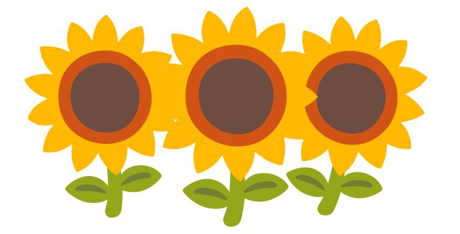

# Shared-state emoji LFSR prototype

Experimental artwork and shaping prototypes, kept outside the production font
build so they can be edited independently.

- [Artwork and SVG generation](artwork/README.md): two/three-zombie hordes and
  sunflower clusters, with original Noto vectors and PNG previews.
- [Feature rules](demo.fea) and [test-font builder](demo.py): shared binary
  LFSR state across two different emoji bases.

From this directory, regenerate the vectors with `python artwork/build_hordes.py`.
The checked-in PNG previews were rendered with Inkscape at 384 pixels high.
The included `demo.ttf` is an empty-outline shaping fixture, not an emoji font
to install. None of these files are wired into the main Noto build yet.

Run `python demo.py`. Requires Python fontTools and the system HarfBuzz shared
library. The script builds an empty-outline test font and checks actual shaping;
demo.ttf is deliberately not a usable emoji font.

`demo.fea` is the implementation. It expands each neutral base to `state0 base`,
advances a degree-three binary LFSR with four contextual rules, then assembles
each state/base pair into its final glyph. The first three items seed with 1;
the resulting recurrence has period seven. A noneligible glyph breaks the run.
Feedback operates across mixed bases, with no family-specific feedback rules.

The prototype always varies eligible neutral bases, including short runs.
For a minimum-three policy, guard expansion with contextual lookups matching
eligible input on either side; preserve the explicit-input policy separately.

## Integrating with Noto

- Resolve actual base and finished glyph names from the selected build's cmap
  and GSUB sequences. The names in this demo are abstract.
- Add state0/state1 as unencoded empty glyphs with zero advance to the source
  font, including applicable horizontal/vertical metrics and outline tables.
- Generate family-specific Expand and Assemble mappings from supported variants.
  Keep the four Feedback rules shared across all eligible bases.
- Install these lookups before existing emoji assembly consumes the eligible
  input. Define ordering within the relevant enabled feature stage, rather than
  relying on the ordering of feature declarations in a feature file.
- Preserve existing GSUB, GPOS, and GDEF when integrating. The demo's
  addOpenTypeFeatures call is for a fresh font: do not apply it naively to an
  existing Noto binary, since feature compilation can replace existing tables.
- Avoid expanding explicitly toned/gendered input unless that is intended.
  Recognize those sequences before applying the neutral-input expansion rules.

The example directly ligates state/base to the finished variant, avoiding any
requirement that existing Noto assembly recognize newly inserted sequences.
An alternative resolves state to real modifier glyph sequences and then calls
the existing assembly lookups, after checking their exact expected input order.

For additional independent state channels (gender, tone), use a fixed internal
layout and separate feedback passes before assembly. Six tone choices and three
gender choices are not binary channels: choose an appropriate recurrence over
a finite field, or map binary state to supported output choices with a stated
bias/period policy. Do not assume arbitrary mod-6 arithmetic has maximal-period
LFSR properties. Final mappings still scale with the supported output variants.

Shaping state lives only within a shaping run. Direction, script, font fallback,
application feature settings, and incremental reshaping can affect results;
validate the intended applications and run boundaries before shipping.
